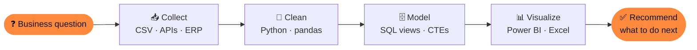

<!--
  Concept profile README.
  Every visual in art/concept/ is an animated SVG made by art/concept/generate.py,
  in a light and a dark version. Edit the numbers or text there and rerun:
      python art/concept/generate.py art/concept
-->

<!-- ========================= HERO ========================= -->
<p align="center">
  <picture>
    <source media="(prefers-color-scheme: dark)" srcset="art/concept/hero-dark.svg" />
    <source media="(prefers-color-scheme: light)" srcset="art/concept/hero-light.svg" />
    
  </picture>
</p>

<p align="center">
  <a href="https://www.linkedin.com/in/nii-oye-kpakpo-5b9997248/"></a>
  <a href="mailto:nhyirakpakpo@gmail.com"></a>
  <a href="https://app.joinhandshake.com/profiles/hbtfa3"></a>
  
</p>

<br />

## 🧾 `SELECT * FROM about_me;`

```sql
SELECT  name, school, graduating, based_in, open_to
FROM    people
WHERE   github = 'Alucardz18';

-- name          | Nii-Oye Kpakpo
-- school        | North Carolina A&T, B.S. Computer Science
-- graduating    | December 2026
-- based_in      | Greensboro, NC (open to relocating)
-- open_to       | data, business, operations and supply chain analyst roles, IT support
-- side_quest    | Ashbound, a roguelite platformer in Godot
-- achievement   | 3rd place, HackNCAT 8.0
```

<br />

## 📊 Analyst mode

Each card is a real finding from one of my projects. Click one to open the repo.

<p align="center">
  <a href="https://github.com/Alucardz18/supply-chain-automation">
    <picture>
      <source media="(prefers-color-scheme: dark)" srcset="art/concept/card-supply-dark.svg" />
      <source media="(prefers-color-scheme: light)" srcset="art/concept/card-supply-light.svg" />
      
    </picture>
  </a>
</p>

<p align="center">
  <a href="https://github.com/Alucardz18/Asheville-Airbnb-Listings-Analysis">
    <picture>
      <source media="(prefers-color-scheme: dark)" srcset="art/concept/card-airbnb-dark.svg" />
      <source media="(prefers-color-scheme: light)" srcset="art/concept/card-airbnb-light.svg" />
      
    </picture>
  </a>
</p>

<p align="center">
  <a href="https://github.com/Alucardz18/U.S.-EV-Market-Share">
    <picture>
      <source media="(prefers-color-scheme: dark)" srcset="art/concept/card-ev-dark.svg" />
      <source media="(prefers-color-scheme: light)" srcset="art/concept/card-ev-light.svg" />
      
    </picture>
  </a>
</p>

### How I work



<br />

## 🎮 Builder mode

<p align="center">
  <picture>
    <source media="(prefers-color-scheme: dark)" srcset="art/concept/ashbound-dark.svg" />
    <source media="(prefers-color-scheme: light)" srcset="art/concept/ashbound-light.svg" />
    
  </picture>
</p>

- 🔥 **Ashbound:** a roguelite platformer we're building in **Godot** for senior design
- 🏆 **HackNCAT 8.0:** 3rd place
- ☕ Also built a **Java** brick breaker and a **C++** movie ticketing system

<br />

## 🎖️ Off the keyboard

<details>
<summary><b>U.S. Marine Corps Reserve: Supply and Logistics Specialist</b> (click to expand)</summary>
<br />

- Reconcile **$17M+ in equipment** in the GCSS-MC ERP system with **zero inspection discrepancies**
- Built a **Power Apps** tracking tool at Camp Lejeune that cut the workload by **20%**
- Cut reporting delays by about **11%**
- Squad Leader of 11 Marines, tracking readiness for 34

This is where I learned that clean data is a readiness issue, not a nice-to-have.
</details>

<br />

## 🛠️ Toolbox

| Analyze | Build | Support |
|:--|:--|:--|
| <br/>Power BI · Excel · Power Query · DAX · pandas · NumPy · scikit-learn · Jupyter | <br/>HTML · CSS · Power Apps | <br/>CompTIA A+ |

<br />

## 📈 Activity

<p align="center">
  
</p>

<p align="center">
  <picture>
    <source media="(prefers-color-scheme: dark)" srcset="https://raw.githubusercontent.com/Alucardz18/Alucardz18/output/github-snake-dark.svg" />
    <source media="(prefers-color-scheme: light)" srcset="https://raw.githubusercontent.com/Alucardz18/Alucardz18/output/github-snake.svg" />
    
  </picture>
</p>

<p align="center"><sub>Thanks for stopping by. If something here is useful to your team, let's talk.</sub></p>
